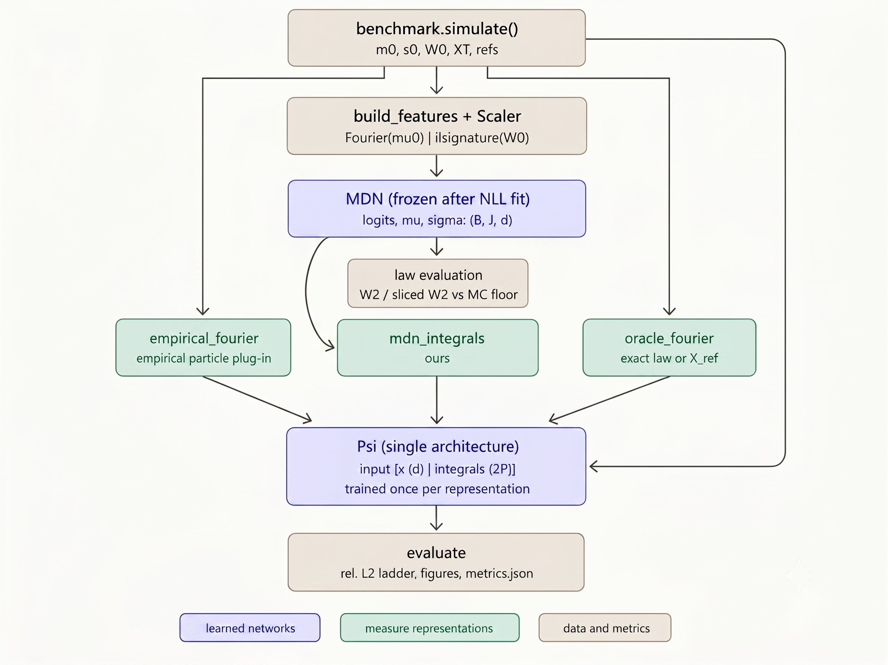
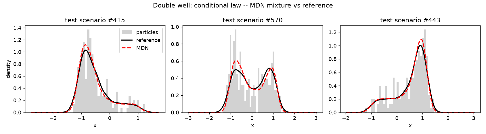
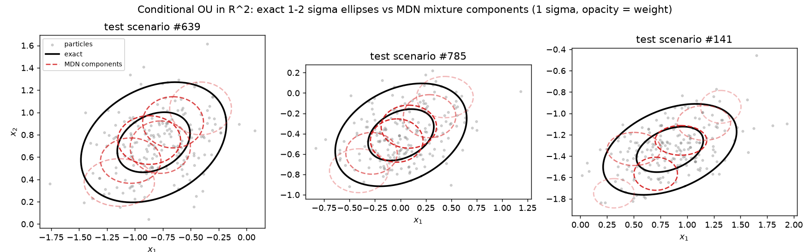
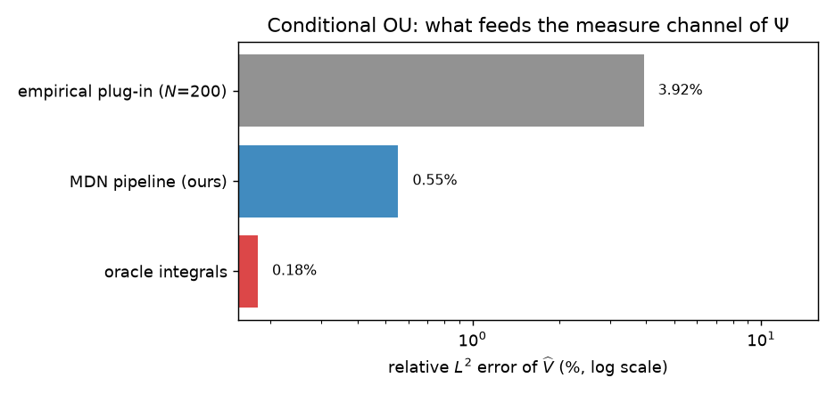

# Cylindrical approximation of conditional laws — McKean–Vlasov with common noise


Companion code for

> N. Agram, J. Rems, R. Hmioui, *Cylindrical approximation of conditional
> laws for McKean–Vlasov equations with common noise*, preprint, 2026.

The accompanying paper proves a universal approximation theorem for
functionals $V(x,\mu_t)$ of the conditional law
$\mu_t=\mathcal L(X_t\mid\mathcal F_t^{W^0})$
of a McKean–Vlasov equation with common noise. The proposed factorized
architecture combines finite-dimensional features of the initial law,
a truncated signature of the time-augmented common-noise path, a
mixture-density network approximating the conditional law, and a
cylindrical network evaluating the target functional:

$$
\widehat V(x,\mu_0,\mathbf w)
=
\Psi\!\left(
x,
\left\langle
\varphi,
\widehat N\!\left(E_L(\mu_0),S_M(\mathbf w_{[0,t]})\right)
\right\rangle
\right).
$$

This repository implements and evaluates this architecture on four
benchmarks.

**No nested resimulation in the learned estimator.**
A single terminal-particle observation per common-noise scenario gives an
unbiased stochastic-gradient estimate of the conditional negative
log-likelihood; using $K_{\mathrm{keep}}>1$ particles only reduces gradient
variance. After training, the Fourier integrals of the predicted Gaussian
mixture are computed analytically, so evaluating the cylindrical network
requires neither a new particle simulation nor an inner Monte-Carlo loop.
Particle systems are still used to generate training data and reference
quantities for evaluation.

## Architecture



The pipeline encodes the initial law and common-noise path, learns the
conditional law with an MDN, and evaluates functionals through a
cylindrical network.

## Benchmarks

The implementation includes four benchmarks covering exact Gaussian laws,
nonlinear multimodal laws, state-dependent common noise, and a
multidimensional state space.

| Benchmark | Dimension | Reference law | Numerical scheme | Purpose |
|---|---:|---|---|---|
| `ou` | 1 | Exact conditional Gaussian law | Euler–Maruyama | Closed-form validation |
| `double_well` | 1 | Large reference particle system `X_ref` | Tamed Euler | Nonlinear and potentially bimodal conditional laws |
| `multiplicative` | 1 | Large reference particle system `X_ref` | Euler–Maruyama; Heun for the Itô–Stratonovich check | State-dependent common-noise coefficient |
| `ou2d` | 2 | Exact two-dimensional Gaussian law | Euler–Maruyama | Multidimensional measure input and sliced Wasserstein evaluation |

The `double_well` and `multiplicative` benchmarks inherit the shared
reference-particle implementation from `particle_ref.py`. The `ou` and
`ou2d` benchmarks inherit directly from the common benchmark interface in
`base.py`.

## Evaluation

The conditional-law approximation is evaluated using:

- the Wasserstein distance $W_2$ in dimension one;
- sliced $W_2$ in dimension two;
- the Monte Carlo floor associated with an $N$-particle empirical cloud;
- `reference_resolution` when the reference law is approximated by a finite
  reference particle system;
- the relative $L^2$ error of the cylindrical approximation $\widehat V$.

The experiments consider two target functionals:

1. a moment-based functional, available in dimensions one and two;
2. a quantile/tail functional, available for the one-dimensional benchmarks.

Their definitions are given in the [Target functionals](#target-functionals)
section below.

The measure channel of the cylindrical network is evaluated using three
representations:

1. **Empirical plug-in:** Fourier integrals computed from the simulated
   $N$-particle cloud;
2. **MDN pipeline:** Fourier integrals computed analytically from the
   predicted Gaussian mixture;
3. **Oracle representation:** Fourier integrals computed from the exact
   conditional law, when available, or from the large reference particle
   system `X_ref`.

The three variants use the same target functional within each experiment,
but they are trained separately and use evaluation points $x$ sampled
independently from the same distribution.

## Target functionals

The experiments consider two target functionals.

### Moment functional

```math
V_{\mathrm{mom}}(x,\mu)
=
\langle x,m_1(\mu)\rangle
+
\mathrm{tr}\!\left(\mathrm{Cov}(\mu)\right)
+
\sin(x_1).
```

### Quantile/tail functional

```math
V_{\mathrm{quant}}(x,\mu)
=
x\left(q_{0.75}(\mu)-q_{0.25}(\mu)\right)
+
F_\mu(0)
+
\sin(x).
```

Here, $q_{0.75}(\mu)-q_{0.25}(\mu)$ is the interquartile range and
$F_\mu(0)$ is the conditional probability of being below zero. This
target is not, in general, determined by any fixed finite collection of
ordinary moments and is particularly informative for the bimodal
double-well benchmark.

Both experiments use the same Fourier representation of the measure;
only the regression target supplied to the cylindrical network changes.

## Results

The following results were obtained with seed `0` and the full
configurations stored in `configs/<benchmark>.json`. Detailed parameters,
metrics and runtimes are saved in each experiment's `metrics.json`.

### Conditional-law approximation

| Benchmark | Validation NLL | $W_2$ / sliced $W_2$ | Monte Carlo floor | Reference resolution |
|---|---:|---:|---:|---:|
| `ou` | 0.3012 (entropy floor: 0.3022) | **0.0066 ± 0.0035** | 0.0525 ± 0.0252 | Exact reference |
| `double_well` | 0.8340 | **0.0290 ± 0.0129** | 0.0724 ± 0.0310 | 0.0305 |
| `multiplicative` | 0.0190 | **0.0150 ± 0.0084** | 0.0302 ± 0.0096 | 0.0135 |
| `ou2d` | 0.1988 (entropy floor: 0.1823) | **0.0060 ± 0.0034** | 0.0449 ± 0.0147 | Exact reference |

The reported standard deviations are computed across test scenarios.
The one-dimensional benchmarks use $W_2$, while `ou2d` uses sliced
$W_2$.

The MDN error is below the finite-particle Monte Carlo floor on all four
benchmarks. This comparison quantifies the benefit of pooling information
across many common-noise scenarios; it is not a like-for-like comparison
between estimators trained from the same amount of information.

For `ou`, the validation NLL is close to the entropy of the exact
conditional Gaussian law. For `double_well`, the MDN Wasserstein error is
approximately equal to the measured resolution of the finite
$N_{\mathrm{ref}}=2000$ reference system.



*Predicted Gaussian-mixture densities against the large-particle reference
for three double-well test scenarios.*



*Exact conditional Gaussian ellipses and diagonal-mixture components
predicted by the MDN for three two-dimensional test scenarios.*

### Moment functional

For the moment-based target, the relative test $L^2$ errors are:

| Measure representation | `ou` | `double_well` | `multiplicative` | `ou2d` |
|---|---:|---:|---:|---:|
| Empirical plug-in, $N=200$ | 3.92% | 4.24% | 1.30% | 3.05% |
| **MDN pipeline** | **0.55%** | **2.13%** | **0.89%** | **0.56%** |
| Oracle integrals | 0.18% | 0.22% | 0.17% | 0.23% |

The MDN representation improves over the empirical particle plug-in on all
four benchmarks. The remaining difference between the MDN and oracle rows is indicative of
the effect of conditional-law approximation, together with the training
and regression error of the cylindrical network.

The empirical, MDN and oracle networks have the same architecture, but are
trained independently. They use the same target functional and evaluation points $x$ sampled
independently from the same distribution.



*Relative test error obtained from empirical particle integrals, the MDN
representation, and oracle integrals on the conditional OU benchmark.*


### Quantile/tail functional

The quantile experiment is available for the one-dimensional `ou` and
`double_well` benchmarks:

| Measure representation | `ou` | `double_well` |
|---|---:|---:|
| Empirical plug-in, $N=200$ | 5.02% | 5.68% |
| **MDN pipeline** | **0.82%** | **2.72%** |
| Oracle integrals | 0.44% | 1.34% |

The inputs to the cylindrical network remain the same Fourier integrals.
Only the target functional changes. In particular, the double-well target
contains $F_\mu(0)$, which describes the conditional occupancy of the left
well.

### Itô–Stratonovich check

The `multiplicative` benchmark has a state-dependent common-noise
coefficient, so the Itô–Stratonovich correction is non-zero.

The three-scheme experiment uses the same Brownian increments with
$M=300$ scenarios, $N=2000$ particles and 200 time steps:

| Scheme comparison | Mean $W_2$ gap |
|---|---:|
| Itô Euler–Maruyama vs corrected Stratonovich Heun | **0.0045** |
| Itô Euler–Maruyama vs naive Stratonovich Heun | **0.0494** |
| Estimated Monte Carlo resolution | 0.0136 |

The corrected Heun scheme agrees with the Itô discretization below the
estimated Monte Carlo resolution, whereas omitting the drift correction produces a
clearly measurable discrepancy.


## Installation

### Windows prerequisites

The `iisignature` package contains a compiled C++ extension. Before
installing the Python dependencies on Windows, make sure that
**Microsoft C++ Build Tools 14.0 or later** is installed, including:

- Desktop development with C++;
- MSVC x64/x86 build tools;
- Windows 10 or Windows 11 SDK.

### Clone and install

```powershell
git clone https://github.com/HmiouiReda/cylindrical-mckean-vlasov.git
cd cylindrical-mckean-vlasov

python -m venv .venv
.\.venv\Scripts\Activate.ps1

python -m pip install --upgrade pip setuptools wheel
python -m pip install -r requirements.txt
```
## Usage

Run all commands from the repository root with the virtual environment activated.

### Tests

```bash
python -m pytest tests -v 
```

### Full benchmark configurations
```bash
python main.py --benchmark ou --baselines full --outdir outputs/ou

python main.py --benchmark double_well --baselines full --outdir outputs/double_well

python main.py --benchmark multiplicative --baselines full --outdir outputs/multiplicative

python main.py --benchmark ou2d --baselines full --outdir outputs/ou2d
```

The option `--baselines full` trains and evaluates three measure
representations:

1. empirical Fourier integrals computed from the particle cloud;
2. Fourier integrals computed analytically from the MDN mixture;
3. oracle Fourier integrals computed from the exact law or from `X_ref`.

### Quantile/tail functional

The quantile functional is available for the one-dimensional benchmarks.

```bash
python main.py --benchmark ou --functional quantile --baselines full --outdir outputs/ou_quantile

python main.py --benchmark double_well --functional quantile --baselines full --outdir outputs/double_well_quantile
```

The Fourier representation supplied to the cylindrical network remains
unchanged; only the target functional changes.

### Itô–Stratonovich consistency check

```bash
python main.py --benchmark multiplicative --ito-strat-check --outdir outputs/multiplicative
```

This compares the Itô Euler–Maruyama scheme with corrected and uncorrected
Stratonovich Heun schemes. The results are written to:

```text
outputs/multiplicative/ito_strat_check.json
```

### Multi-seed experiment

```bash
python run_seeds.py --benchmark ou --seeds 0,1,2,3,4 -- --baselines emp --psi-epochs 150
```

The individual runs and aggregated statistics are stored under:

```text
outputs/ou_seeds/
├── seed0/
├── seed1/
├── seed2/
├── seed3/
├── seed4/
└── summary.json
```

### Training diagnostics

Strict single-particle training:

```bash
python main.py --benchmark ou --single-particle --outdir outputs/ou_single_particle
```

Gradient-flow overfit test:

```bash
python main.py --benchmark ou --overfit-test
```

Study the effect of the number of retained particles:

```bash
python main.py --benchmark ou --sweep-kkeep 1,8,64,200 --outdir outputs/ou_kkeep_sweep
```

Signature-level experiment:

```bash
python main.py --benchmark double_well --sig-level 1 --outdir outputs/double_well_sig1
```

Empirical target statistics:

```bash
python main.py --benchmark ou --empirical-targets --baselines full --outdir outputs/ou_empirical_targets
```

## Generated outputs

A standard run writes `metrics.json` and several figures to the selected
output directory. Typical outputs are:

```text
metrics.json
fig1_benchmark_density.png
fig2_mdn_vs_ref.png
fig3_training_curves.png
fig4_w2_floor.png
fig5_baselines.png
```

The comparison figure is generated when `--baselines full` is enabled.
Figure names or contents may differ for benchmark-specific and
multidimensional evaluations.

Default hyperparameters are stored in:

```text
configs/<benchmark>.json
```

The complete run configuration, metrics and measured runtime are recorded
in `metrics.json`.

## Repository layout

```text
.
├── benchmarks/
│   ├── base.py              # Common benchmark API
│   ├── particle_ref.py      # Base class and X_ref utilities for particle-reference benchmarks
│   ├── ou.py                # One-dimensional conditional OU with exact Gaussian reference
│   ├── double_well.py       # Bistable dynamics, tamed Euler and large X_ref system
│   ├── multiplicative.py    # State-dependent common noise and Itô–Stratonovich check
│   └── ou2d.py              # Two-dimensional conditional OU with exact Gaussian reference
│
├── configs/                 # Per-benchmark hyperparameters in JSON format
│
├── docs/
│   ├── architecture/        # Architecture, sequence and neural-network diagrams
|   ├── results/             # Selected figures displayed in the README
│    
│
├── tests/                   # Unit, numerical-identity and end-to-end pipeline tests
├── outputs/                 # Generated metrics and figures
│
├── features.py              # Fourier features of μ₀ and time-augmented path signatures
├── mdn.py                   # Mixture-density network and NLL training loop
├── cylindrical.py           # Cylindrical Ψ network and Fourier measure representations
├── evaluate.py              # W₂, sliced W₂, MC floor, relative L² metrics and figures
├── main.py                  # End-to-end pipeline and command-line interface
├── run_seeds.py             # Multi-seed execution and metric aggregation
├── requirements.txt         # Python dependencies
└── README.md                # Project overview, installation, usage and main results
```

The benchmark inheritance structure is:

```text
Benchmark
├── OrnsteinUhlenbeck
├── OU2d
└── ParticleReferenceBenchmark
    ├── DoubleWell
    └── Multiplicative
```

`ou.py` and `ou2d.py` inherit directly from the common benchmark base
class. `double_well.py` and `multiplicative.py` inherit from
`particle_ref.py`, which provides the shared large-reference-particle
machinery.


## Reproducibility

All main results use seed `0` and the full configurations in `configs/`.
Each run saves its configuration, metrics and runtime in
`outputs/<benchmark>/metrics.json`.

