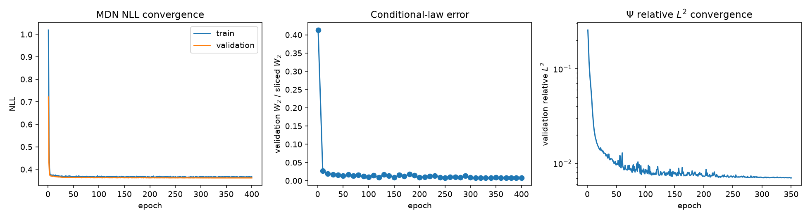
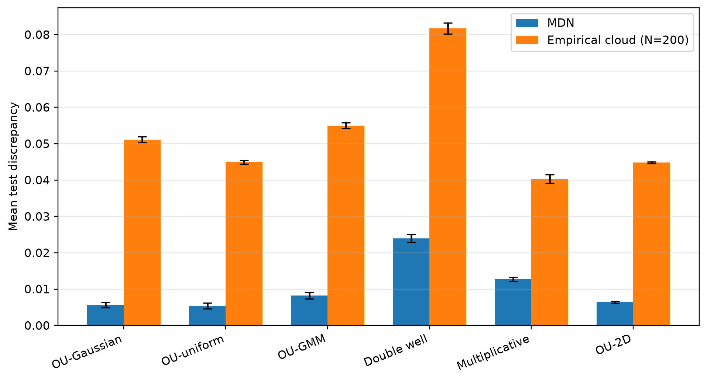
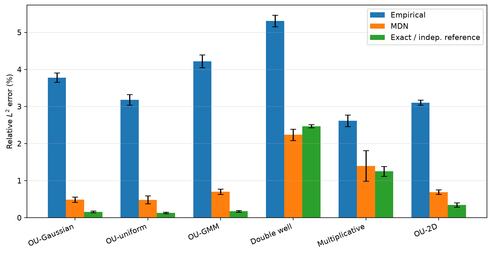
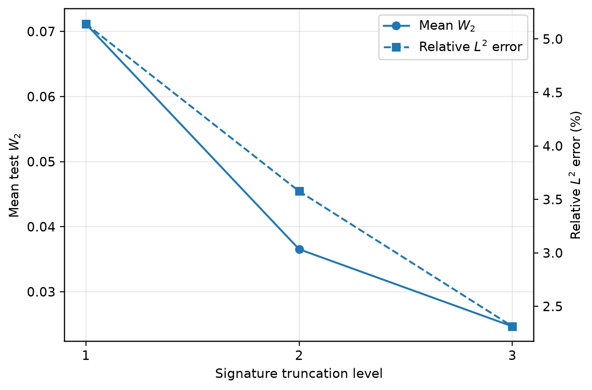
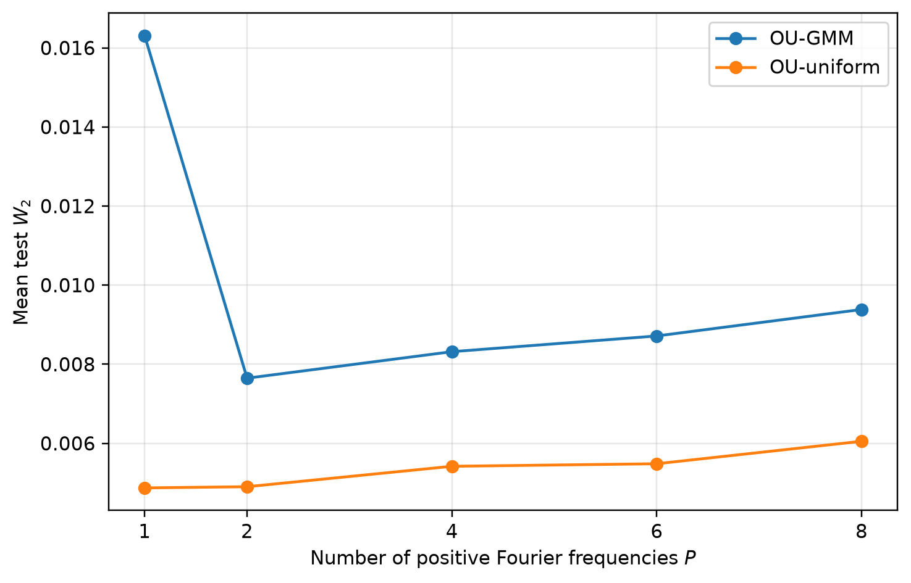

# Cylindrical neural approximation of conditional laws for McKean–Vlasov equations with common noise


Companion implementation for the 2026 manuscript by **Nacira Agram, Reda Hmioui, and Jan Rems**.

The project approximates functionals of the conditional law

```math
\mu_t=\mathcal L\!\left(X_t\mid\mathcal F_t^{W^0}\right)
```

of a McKean–Vlasov equation with common noise. For a fixed evaluation time $t$, the frozen-common-noise law is written

```math
\mu_t(\mathbf w)=\Phi_t\!\left(\mu_0,r_t\mathbf w\right),
\qquad
r_t\mathbf w:=\mathbf w\big|_{[0,t]}.
```

The restriction operator $r_t$ is essential: by causality, the conditional law at time $t$ and its signature features depend only on the common-noise rough path observed up to time $t$. The factorized architecture is

```math
\widehat V(x,\mu_0,\mathbf w)
=
\Psi\!\left(
 x,
 \left\langle\varphi,
 \widehat N\!\left(g_M(\mu_0,r_t\mathbf w)\right)
 \right\rangle
\right),
```

with

```math
g_M(\mu_0,r_t\mathbf w)
=
\left(E_L(\mu_0),S_M(r_t\mathbf w)\right).
```

Here, $E_L(\mu_0)$ contains Fourier moments of the initial law and $S_M(r_t\mathbf w)$ is the truncated signature of the restricted, time-augmented geometric common-noise rough path. A mixture-density network (MDN) predicts a Gaussian-mixture approximation of $\Phi_t(\mu_0,r_t\mathbf w)$, and a cylindrical network evaluates the target functional through analytic integrals against the predicted mixture.

## Architecture


The common-noise branch first applies the causal restriction $r_t$, then computes $S_M(r_t\mathbf w)$. At inference time, Fourier integrals of the Gaussian mixture predicted by the MDN are evaluated analytically, so no new interacting particle system or inner Monte Carlo loop is required.

## Benchmarks

| Benchmark | Dimension | Initial law | Conditional-law reference | Main purpose |
|---|---:|---|---|---|
| `ou` | 1 | Gaussian | Exact Gaussian | Closed-form validation |
| `ou_uniform` | 1 | Uniform | Exact uniform–Gaussian convolution | Non-Gaussian initial law |
| `ou_gmm` | 1 | Two-component Gaussian mixture | Exact Gaussian mixture | Multimodal initial law |
| `double_well` | 1 | Gaussian | Two independent reference systems | Nonlinear and potentially bimodal dynamics |
| `multiplicative` | 1 | Gaussian | Two independent reference systems | State-dependent common noise |
| `ou2d` | 2 | Gaussian | Exact correlated Gaussian | Multidimensional conditional law |

All models use scalar common noise. The first three benchmarks share the same conditional OU dynamics and differ only through the initial-law family, isolating the role of the Fourier encoding.

## Leakage-free reference design

For `double_well` and `multiplicative`, no closed-form conditional law is available. Each scenario therefore uses two conditionally independent reference systems, A and B, sharing only $(\mu_0,W^0)$:

- reference A supplies measure inputs to the independent-reference cylindrical baseline;
- reference B supplies regression targets;
- the pooled cloud $A\cup B$ is used only for law-level validation and density diagnostics.

This prevents direct reuse of the same finite particle realization for both the measure representation and the regression target. Remaining finite-reference uncertainty is reported separately.

## Figures from the paper

The five images below are the **exact PNG assets embedded in the current manuscript**, displayed in the same order as Figures 1–5 of the paper.

### Figure 1 — optimization diagnostics



Representative optimization curves for the OU–GMM benchmark at seed 0: MDN training and validation NLL, validation conditional-law discrepancy, and downstream $\Psi$ relative $L^2$ error.

### Figure 2 — conditional-law approximation



Mean test law discrepancy for the MDN and the empirical $N=200$ particle cloud. Error bars are standard deviations across five independent seeds. The one-dimensional benchmarks use $W_2$, while `ou2d` uses sliced $W_2$.

### Figure 3 — moment-functional approximation



Moment-functional relative $L^2$ error for the empirical, MDN, and exact/independent-reference measure channels. Error bars are standard deviations across five seeds.

The functional is

$$
V_{\mathrm{mom}}(x,\mu) = \langle x,m_1(\mu)\rangle + \mathrm{tr} \left(\mathrm{Cov}(\mu)\right) + \sin(x_1).
$$

### Figure 4 — signature-depth sensitivity



Double-well sensitivity to signature truncation. Both law and functional errors decrease materially from levels 1 to 3.

### Figure 5 — Fourier-order sensitivity



Fourier-order sensitivity for the two non-Gaussian OU benchmarks. The GMM family needs more than one positive frequency, whereas the uniform family is already stable at low order.

## Headline numerical results

### Conditional-law approximation

| Benchmark | Validation NLL | MDN discrepancy | Empirical `N=200` | Reference resolution |
|---|---:|---:|---:|---:|
| OU–Gaussian | 0.2951 ± 0.0045 | **0.0057 ± 0.0008** | 0.0511 ± 0.0008 | Exact |
| OU–uniform | 0.2187 ± 0.0033 | **0.0054 ± 0.0008** | 0.0450 ± 0.0005 | Exact |
| OU–GMM | 0.3642 ± 0.0023 | **0.0082 ± 0.0009** | 0.0550 ± 0.0008 | Exact |
| Double well | 0.8373 ± 0.0064 | **0.0240 ± 0.0011** | 0.0817 ± 0.0015 | 0.0179 ± 0.0003 |
| Multiplicative | 0.0232 ± 0.0086 | **0.0127 ± 0.0006** | 0.0403 ± 0.0012 | 0.0092 ± 0.0001 |
| OU–2D | 0.1977 ± 0.0072 | **0.0064 ± 0.0003** | 0.0448 ± 0.0002 | Exact |

The comparison with the empirical $N=200$ representation is amortized: the MDN learns structure shared across many common-noise scenarios, while the empirical cloud is reconstructed independently within each test scenario.

### Moment functional

| Benchmark | Empirical `N=200` | MDN pipeline | Exact / independent reference |
|---|---:|---:|---:|
| OU–Gaussian | 3.78% ± 0.13% | **0.49% ± 0.07%** | 0.16% ± 0.02% |
| OU–uniform | 3.18% ± 0.14% | **0.48% ± 0.11%** | 0.13% ± 0.02% |
| OU–GMM | 4.22% ± 0.17% | **0.70% ± 0.07%** | 0.18% ± 0.02% |
| Double well | 5.31% ± 0.15% | **2.24% ± 0.15%** | 2.47% ± 0.04% |
| Multiplicative | 2.62% ± 0.15% | **1.40% ± 0.41%** | 1.25% ± 0.13% |
| OU–2D | 3.11% ± 0.07% | **0.69% ± 0.06%** | 0.35% ± 0.06% |

For `double_well` and `multiplicative`, the last column is a leakage-free independent-reference channel rather than an exact oracle.

### Quantile-and-tail stress test

For the one-dimensional benchmarks, the repository also evaluates

```math
V_{\mathrm{quant}}(x,\mu)
=
x\bigl(q_{0.75}(\mu)-q_{0.25}(\mu)\bigr)
+F_\mu(0)+\sin(x).
```

This target is a numerical stress test beyond the theorem’s global continuity assumptions. In the paper it is reported as a table, not as an additional figure.

## Additional numerical checks

The manuscript and repository also include:

- strict single-particle training;
- a `K_keep` particle-subsampling sweep;
- learning-rate, mixture-size, Fourier-order, MDN-depth, and $\Psi$-depth sweeps;
- an Itô–Stratonovich consistency check for the multiplicative benchmark.

For the consistency check, the corrected Stratonovich scheme has mean $W_2$ gap `0.00449` to the Itô reference, below the estimated Monte Carlo resolution `0.01360`; the naive uncorrected scheme has gap `0.04941`.

Compact per-run and aggregated results are committed under [`results/`](results/). Raw experiment folders are intentionally excluded from Git.

## Installation

### Windows prerequisite

`iisignature` contains a compiled extension. On Windows, install Microsoft C++ Build Tools with **Desktop development with C++**, an MSVC x64/x86 toolchain, and a Windows SDK.

### Clone and install

```powershell
git clone https://github.com/HmiouiReda/cylindrical-mckean-vlasov.git
cd cylindrical-mckean-vlasov

python -m venv .venv
.\.venv\Scripts\Activate.ps1
python -m pip install --upgrade pip setuptools wheel
python -m pip install -r requirements.txt
```

## Quick start

Run commands from the repository root with the virtual environment activated.

```powershell
python main.py --benchmark ou --quick --outdir outputs/quick_ou
```

A standard run writes `metrics.json`, `training_history.json`, and benchmark-specific figures to the selected output directory.

## Reproduce the paper campaign

The PowerShell driver executes the complete experiment plan, skips already completed runs unless `-Force` is passed, records a manifest, and aggregates the results at the end.

```powershell
.\run_all.ps1
```

Useful options:

```powershell
.\run_all.ps1 -Quick
.\run_all.ps1 -Force
.\run_all.ps1 -Clean
.\run_all.ps1 -StopOnError
```

To rebuild the summaries and plots from existing raw outputs:

```powershell
python aggregate_full_results.py --root outputs/paper_full
```

Aggregation writes CSV, JSON, and figures under `outputs/paper_full/aggregate/` without modifying the raw runs.

## Individual experiments

### Full moment-functional benchmark

```powershell
python main.py --benchmark ou_gmm --functional moments --baselines full --outdir outputs/ou_gmm
```

Available benchmark names are:

```text
ou, ou_uniform, ou_gmm, double_well, multiplicative, ou2d
```

### Quantile-and-tail functional

```powershell
python main.py --benchmark ou_uniform --functional quantile --baselines full --outdir outputs/ou_uniform_quantile
```

### Multi-seed run

```powershell
python run_seeds.py --benchmark ou_gmm --seeds 0,1,2,3,4 -- --baselines full
```

### One-factor-at-a-time sweeps

```powershell
python sweeps.py --benchmark ou_gmm --parameter J --values 1,2,3,5,8
python sweeps.py --benchmark ou_uniform --parameter n_fourier --values 1,2,4,6,8
python sweeps.py --benchmark ou_gmm --parameter lr --values 0.0001,0.0003,0.001,0.003
python sweeps.py --benchmark ou_gmm --parameter mdn_depth --values 1,2,3,4
python sweeps.py --benchmark ou_gmm --parameter psi_depth --values 1,2,3,4
```

### Additional diagnostics

```powershell
python main.py --benchmark ou --single-particle --outdir outputs/ou_single_particle
python main.py --benchmark ou --sweep-kkeep 1,8,64,200 --outdir outputs/ou_kkeep
python main.py --benchmark multiplicative --ito-strat-check --outdir outputs/ito_strat
python main.py --benchmark ou --overfit-test --outdir outputs/ou_overfit
```

## Repository layout

```text
.
├── benchmarks/
├── configs/
├── docs/
│   ├── architecture/
│   │   └── pipeline_architecture_overview.png
│   └── results/
│       ├── figure1_training_convergence_ou_gmm.png
│       ├── figure2_law_error_across_benchmarks.png
│       ├── figure3_functional_error_across_benchmarks.png
│       ├── figure4_signature_depth_double_well.png
│       └── figure5_fourier_sensitivity_non_gaussian.png
├── results/
├── tests/
├── aggregate_full_results.py
├── cylindrical.py
├── evaluate.py
├── features.py
├── main.py
├── mdn.py
├── run_all.ps1
├── run_seeds.py
├── sweeps.py
└── requirements.txt
```

## Tests

```powershell
python -m pytest tests -v
```

## Reproducibility notes

- Main moment-functional tables use seeds `0,1,2,3,4`.
- Quantile-and-tail experiments use seed `0`.
- Default hyperparameters are stored in `configs/<benchmark>.json`.
- Every raw run stores its resolved configuration and runtime in `metrics.json`.
- The MDN is frozen before training each downstream cylindrical network.
- The empirical, MDN, and exact/reference channels use separate copies of the downstream network.
- Theoretical bounded-coefficient assumptions do not cover every numerical benchmark; the OU and double-well drifts are retained as standard test cases.

